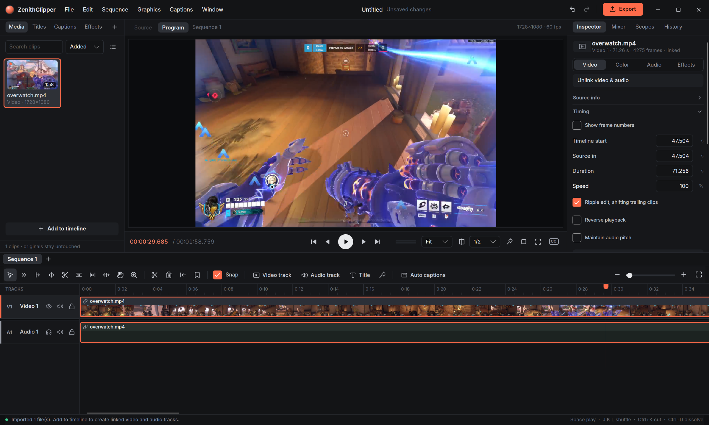
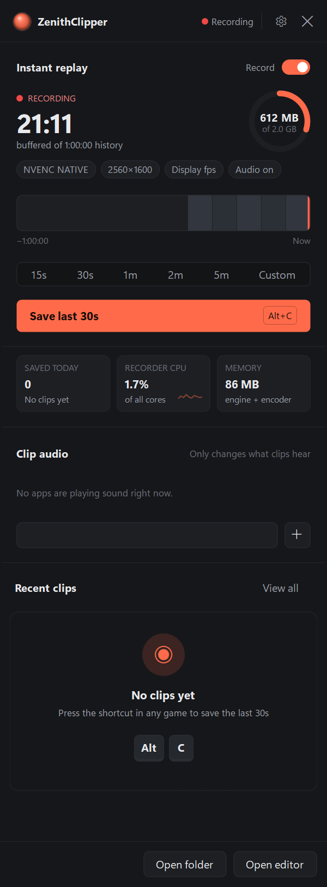
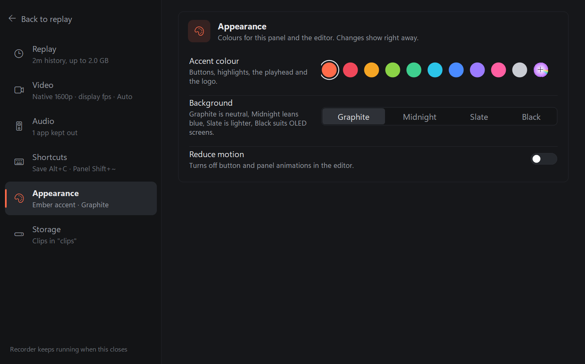
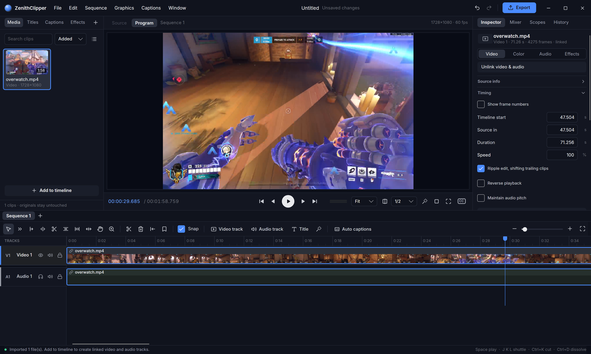

# ZenithClipper

A local replay recorder with a small background engine, an on-demand control panel, and a separate on-demand clip editor. Windows hardware capture and the Linux core/daemon have been tested. Linux desktop capture still needs real desktop validation. See `docs/VERIFICATION.md` for evidence and limits.

## Screenshots

<p align="center"></p>

<p align="center"> </p>

<p align="center"></p>

**Imports** MP4, MOV, MKV, WebM, AVI, MP3, WAV, FLAC, OGG, PNG, JPG, GIF, WebP, PSD and more. **Exports** MP4 (H.264, H.265, AV1, NVENC), MOV, MKV, WebM, animated GIF, MP3, WAV, M4A and FLAC.

## Download

Grab `ZenithClipper-windows-x64.zip` from the latest GitHub release, unzip it anywhere and run `ZenithClipper.Windows.exe`. Needs Windows 10 or 11 (x64) and the .NET 10 Desktop Runtime. NVIDIA, AMD and Intel GPUs get hardware encoding; it never silently falls back to CPU encoding.

Colours live under Settings > Appearance and apply to the panel and the editor.

## Start on Windows

1. Open **Launch ZenithClipper.cmd**. It starts the engine and controls. The engine captures immediately by default.
2. **Alt+C** saves the recent clip. **Shift+~** opens controls (Shift and the backtick/tilde key). Both shortcuts can be changed under **Settings → Shortcuts**: click a shortcut, press your combination, then **Apply**.
3. Close controls when finished configuring. Only the engine and its FFmpeg encoder remain running.
4. Open **Open Editor.cmd**, or use the control panel, to trim/export clips. Closing the editor terminates its process.

The portable Windows build includes the tested **.NET 10.0.14 Desktop Runtime** locally, plus FFmpeg/FFprobe. It installs no system runtime. No account, service, network listener, cloud, telemetry, persistent browser, or social feed.

The package is portable: `build/windows/portable.flag` makes settings, clips, temporary exports, logs, and the rolling buffer live in `build/windows/data`. Change the clip folder in controls if desired. `ZENITHCLIPPER_HOME` overrides the data folder for tests/advanced use. Without the portable marker, data uses the OS local application-data directory.

To start automatically at login, run `scripts/install-startup-windows.ps1`. It creates one user startup shortcut and opens no panel at login. Run it with `-Remove` to disable startup. Startup is supplied as an explicit install step; building/testing does not secretly enable persistent capture.

## Capture

- Clip and retention durations: **1 second to 24 hours**. The disk limit may shorten the available history; hours of high-quality video need substantial space.
- Default: native display dimensions, display refresh rate, hardware H.264 encoding, quality 20. Quality is compressed, not bit-perfect/lossless. The game's variable frame rate is not directly measured.
- `auto` tries real hardware encoder initialization: NVIDIA NVENC, Intel QSV, AMD AMF on Windows; VAAPI/NVENC/QSV on Linux. It never silently switches to CPU encoding. `software` is an explicit, higher-CPU option.
- Windows uses Desktop Duplication for NVIDIA/Intel and AMD-native GPU capture/conversion for AMD in auto mode (requires the bundled FFmpeg 9). NVIDIA native-size capture and AMD capture/scaling avoid CPU-frame downloads. The explicit desktop-duplication compatibility override for AMD, Intel, and resized NVIDIA paths transfer frames through CPU memory. This is a functional baseline, not a claim of minimum possible overhead on every GPU.
- Captures the chosen monitor, including desktop activity. No game injection, DRM bypass, game/window allowlist, HDR preservation, automatic highlight recognition, or webcam capture in this base.
- Clips save by remuxing existing compressed segments plus a finite snapshot of the newest unfinished segment. The newest few buffered/incomplete packets may be absent; a not-yet-decodable tail falls back to complete segments. Fast saves retain the preceding keyframe, so the result can be up to roughly **2 seconds longer** than requested. The editor's precise mode re-encodes for exact boundaries.
- Sleep/display-mode changes or lost capture can stop the engine. Controls display the error; **Resume** restarts a fresh buffer. Capture is not silently claimed active after an error.

## App audio exclusion

In the control panel's **Audio in clips** list, switch off any app that is playing (or add one by name). Exclusion affects the recording; you can still hear those apps. Names match exactly, ignoring case and a `.exe` suffix. New included Windows sessions are picked up on the next background tick (about one second).

One final audio track is encoded. With exclusions on Windows, native eligible process-tree streams are mixed into one bounded PCM stream. That uses a little more work than unfiltered system audio; independent per-app encoded tracks are not produced. Without exclusions, a single native system capture is used.

Windows process-tree capture needs build **20348+** (Windows 11 recommended). If an excluded app is a descendant of an included parent, the engine captures safe sibling branches. The parent's own audio may be omitted because the API cannot separate a parent from only some children. A newly detected excluded descendant invalidates the previous buffer and automatically restarts capture; the save hotkey also rechecks the policy. Process changes are polled about once per second: an excluded child that both starts and exits entirely between scans is a remaining edge case. This is not a security/privacy boundary. Matching names can exclude multiple apps that use the same executable, such as browser instances; tab-level filtering is unavailable. DRM/protected audio may not capture.

The base captures application output, not microphone input. Microphone mixing, independent app volume sliders, and separate tracks are follow-up features, not hidden running subsystems.

## Editor

**Open Editor.cmd** (or the panel scissors button) opens the separate MLT-based editor in `build/editor`. It loads no editor/UI libraries into the recorder. Closing the editor ends its process. Keep `build/editor` beside `build/windows`, whose local .NET runtime and FFprobe it uses.

The new foundation supports importing video/audio/images; arranging multiple video/audio tracks; split, delete, ripple delete, timing, speed/reverse, motion, opacity, gain, track mute/hide/lock; project save/open/autosave/recovery/relink; undo/redo; editable raster titles; SRT import/export; brightness/gamma/blur with numeric effect keyframes; and native-sequence-size/FPS H.264/AAC export with progress/cancel. Playback includes sound. Preview is bounded in size and display rate; export keeps the sequence format. CPU export uses two encoder threads. The first video sets an untouched new sequence to its native dimensions and rational frame rate.

This is **not Premiere feature parity**. Multicam, nested sequence editing, advanced color/scopes, tracking/masks, proxies, broad interchange and many other workflows are not supported yet. A model command or native plugin alone is not counted as a complete user workflow. The old Windows trimmer remains a fallback only if the new package is absent.

Build the editor with `./scripts/build-editor.ps1`; run bounded generated-media and headless checks with `./scripts/test-editor.ps1`. See the [editor build instructions](src/ZenithClipper.Editor.Desktop/README.md).
## Keyboard shortcuts

Defaults are **Alt+C** to save a clip and **Shift+~** to open/close controls; **Shift+backtick** names the same tilde/backtick key. On Windows, open **Settings → Shortcuts**, click the shortcut control, press your combination, then **Apply**. On Linux, choose **Keyboard shortcuts** in the controls menu and enter the two combinations. Linux shortcut execution still needs a real graphical-session check.

The current portable handoff keeps `AutoStartCapture=false`; publishing or changing shortcuts does not enable recording. Resume capture explicitly when wanted. Existing custom combinations are settings, separate from the editor's local timeline shortcuts.
## Linux

See `docs/LINUX.md`. The source includes X11 capture, X11 hotkeys, PulseAudio/PipeWire-compatible exclusion routing, on-demand zenity controls and the separate Avalonia/MLT editor, and an experimental Wayland portal/GStreamer capture helper. Core/media/IPC tests passed on Ubuntu, but **desktop capture paths have not been run on a Linux desktop**. Linux is a development target, not yet a verified desktop release.

## Build and test

Windows SDK was downloaded locally into `tools/dotnet`; it is a build dependency and never runs in the recorder. The recorder has no NuGet application dependencies; the separate editor uses Avalonia and native MLT.

```powershell
./scripts/dev.ps1 test
./scripts/package-windows.ps1
# Actual media/IPC integration (FFmpeg path as the first argument):
./tests/ZenithClipper.Tests/bin/Debug/net10.0/ZenithClipper.Tests.exe ./build/windows/ffmpeg.exe
# Add --live for short desktop capture and quiet audio-exclusion playback tests.
```

Linux: install .NET SDK 10 and FFmpeg, run `scripts/build-linux.sh`. For core/media tests: `dotnet run --project tests/ZenithClipper.Tests -- /usr/bin/ffmpeg`.

An authorized SSH-only host can run isolated checks using `scripts/test-server.ps1 -Server user@host` after building the tests/Linux package and providing `tools/dotnet-runtime-linux-x64.tar.gz`. It uses one temporary server directory and verifies cleanup, without system installation or capture. Never run it against a host without permission.

See `docs/IPC.md` for the client protocol. See `THIRD_PARTY.md` before redistributing bundled FFmpeg.

